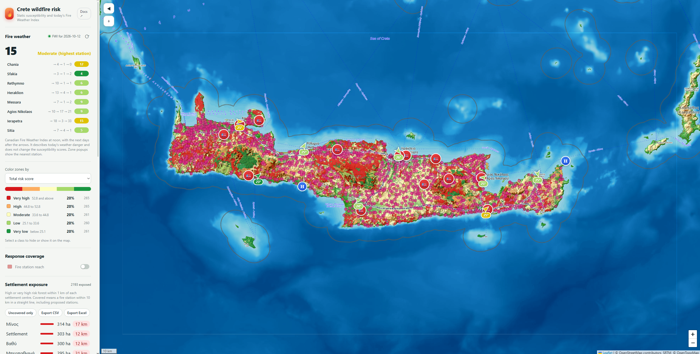

# Crete wildfire risk

An interactive map that ranks Cretan forest zones by **relative wildfire susceptibility**, shows where
fire station coverage is thin, and lists the settlements with the most high-risk forest around them.
It also shows today's Fire Weather Index (FWI) at eight weather stations.

> **This is a planning aid, not a warning system.** It does not predict where or when fires start.
> For alerts use the Civil Protection services (112) and [EFFIS](https://effis.jrc.ec.europa.eu/).



## How it works

```
 QGIS-prepared zones ─┐
 DEM, CORINE, EFFIS ──┴─► backend/build_static_risk.py ─► forests_with_risk_score_v2.geojson ─┐
                                                          + model.json                        │
                                                                                              │
 OSM Greece extract ──────► backend/build_road_network.py ─► data/road_graph.npz ─────────────┤
 (Geofabrik)                                                                                  │
                                                                                              ▼
 Open-Meteo ─► backend/fwi.py ───────────────────────────► backend/main.py (FastAPI)
                                                                      │
                                                                      ▼
                                                  crete-wildfire-dashboard (Angular + Leaflet)
```

- **Static score:** seven factors (fuel, slope, aspect, fire history, distance to power lines, distance to
  roads, next to settlements) scored 0-100 and combined with expert weights. Classes are percentile bands.
- **Validation:** the build script tests the score against fires after 2021 and writes the results to
  `model.json`; the docs page reads them from there.
- **Fire Weather Index:** the Canadian FWI system (Van Wagner 1987), computed from Open-Meteo noon weather.
  Shown beside the score, never mixed into it.
- **Drive-time coverage:** `build_road_network.py` builds a road graph from OpenStreetMap
  (`data/road_graph.npz`). The API uses it to compute minutes from fire stations, including proposed
  ones, to every zone and settlement, and to draw the reachable roads. Speeds are assumptions by road class.

The in-app **Docs** page explains the method, its reliability and its limits in more detail.

## Run it

You need Python 3.10+ and Node 18+.

**1. Data.** See [`backend/data/README.md`](backend/data/README.md).

**2. Backend**

```bash
cd backend
python -m venv .venv && source .venv/bin/activate      # Windows: .venv\Scripts\activate
pip install -r requirements.txt
python build_static_risk.py          # writes the scored zones and model.json
python build_road_network.py         # optional: downloads Greece's OSM extract (a few hundred MB) once
uvicorn main:app --reload            # http://127.0.0.1:8000/docs for the API
```

> Without `data/road_graph.npz` the app still works, in straight-line mode only.
> Restart the API after building the graph, because it is loaded once at start-up.

**3. Frontend**

```bash
cd crete-wildfire-dashboard
npm install
npm install leaflet xlsx && npm install -D @types/leaflet
ng serve                             # http://localhost:4200
```

The API address is set in `src/environments/`. `environment.development.ts` (used by `ng serve`) points
to `http://127.0.0.1:8000/api`.

Leaflet's CSS must be loaded, for example in `angular.json` under `styles`:
`"node_modules/leaflet/dist/leaflet.css"`.

## API

Interactive documentation is served at `/docs` (Swagger UI) when the API is running.

### Drive-time coverage

| Endpoint                                       | Description                                                                                                                                                                                                |
| :--------------------------------------------- | :--------------------------------------------------------------------------------------------------------------------------------------------------------------------------------------------------------- |
| `GET /api/access`                              | Drive times (minutes) from the existing fire stations to every zone and every settlement. Returns `{"available": false}` if the road graph has not been built. `null` means not reached within 45 minutes. |
| `GET /api/access/proposed?p=lat,lng&p=lat,lng` | Same, for proposed stations. Repeat `p` for each station (at most 10, inside Crete). Also returns `snap_m`, the distance from each point to its nearest road.                                              |
| `GET /api/access/roads?max_min=15&p=lat,lng`   | Road segments reachable from the existing stations, plus any proposed `p`, within `max_min` minutes (1 to 45). GeoJSON `MultiLineString` features with a `band` property in 5-minute steps.                |

Zone and settlement results are arrays in the same order as the `/api/risk-zones` (by `zid`) and
`/api/settlements` layers, so the map can match them by position.

### Other endpoints

| Endpoint                         | Description                                                                                                                                         |
| :------------------------------- | :-------------------------------------------------------------------------------------------------------------------------------------------------- |
| `GET /api/model`                 | Weights, class breaks, `train_end` and validation results from `model.json`.                                                                        |
| `GET /api/risk-zones`            | Scored forest zones (GeoJSON) with factor scores, `zid`, `station_id` and `dist_fire_m`.                                                            |
| `GET /api/burned-areas`          | EFFIS burnt areas with `year`, `date` and `area_ha`.                                                                                                |
| `GET /api/weather?refresh=false` | Current weather at the eight stations (cached 10 minutes).                                                                                          |
| `GET /api/fwi?refresh=false`     | Fire Weather Index per station (cached 3 hours).                                                                                                    |
| `GET /api/{layer}`               | Map layers: `power-lines`, `power-nodes`, `power-stations`, `settlements`, `rivers`, `lakes`, `roads`, `fire-stations`, `water-points`, `helipads`. |

## Tests

```bash
cd backend
pip install -r requirements-dev.txt
pytest
```

`validate_fwi.py` is a separate analysis (it downloads weather) that checks whether the FWI separates
fire days from other summer days.

## Limitations

Short fire record (about six years), only larger fires mapped, land cover from 2012, assumed (not measured)
fire-engine speeds for drive times, Crete only. See the Docs page for the full list.

## QGIS Project

The original QGIS project file used for data preparation and styling is available in the [`qgis/`](qgis/) folder.

## Data and attribution

- Contains Copernicus Land Monitoring Service information, © European Union, EEA (CORINE Land Cover 2012).
- Burnt areas: EFFIS. Weather: [Open-Meteo.com](https://open-meteo.com/) (CC BY 4.0).
- Base maps: © OpenTopoMap, OpenStreetMap contributors, SRTM; Esri World Imagery.
- Road network: © OpenStreetMap contributors (ODbL), via Geofabrik.
- Other layers: see [`backend/data/README.md`](backend/data/README.md).

## Licence

This project is licensed under the terms of the **MIT License**. See the [LICENSE](LICENSE) file for details.
_(Note: Spatial data and external layers maintain their own respective licences and attribution terms)._

## Author

- Eva Chrysostomaki - _Initial work & development_ - [GitHub Profile](https://github.com/Eva-Chris)
